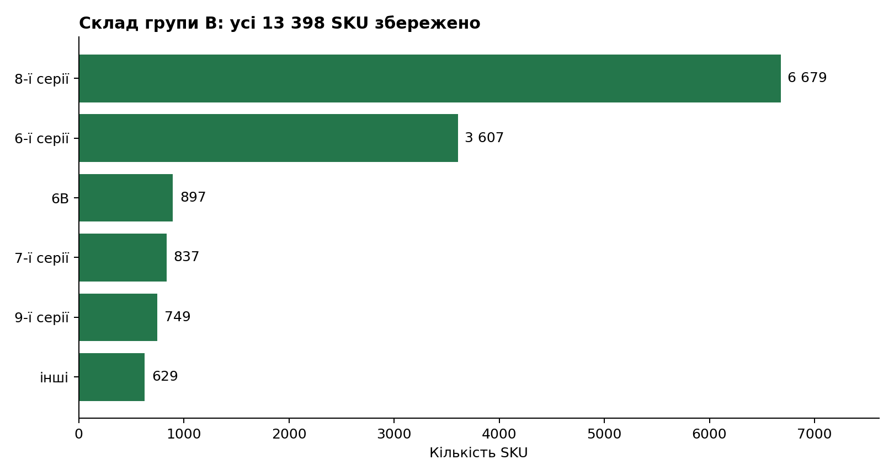
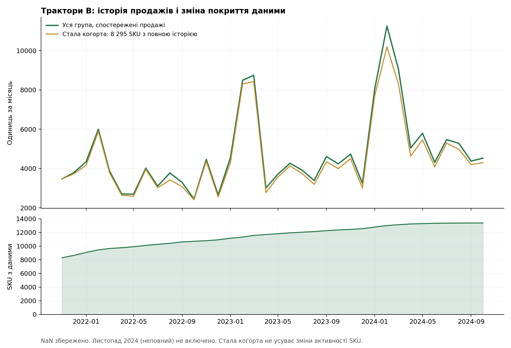

# АГРОСЕМ: виконана частина 1/5 — дані, аудит і сегментація

Група B — «Трактори». Робота учасника №1 за командним планом. Джерела: АГРОСЕМ_case.pdf і 12_11_2024_140029.xlsx. Доданий текст використано як попередню довідку; його висновки перевірено за первинними файлами. Розрахунки виконано для історичного зрізу 12.11.2024, а не для поточної дати.

## 1. Що виконано і що передається команді

Підготовлено відтворюваний набір із 13 398 SKU, календар 36 повних місяців, окремий неповний місяць, перевірки якості, словник полів, реєстр припущень, сегментацію за серіями/CC/IC/поверненням/хітами, попередню ABC/XYZ та списки позицій для перевірки. Excel містить готові зведення, а CSV дають змогу почати прогноз і моделювання без повторного очищення джерела.

Ця частина створює базу для всіх трьох завдань PDF. Формальний прогноз, оцінка Cu/Co і оптимальних SL, COEFF, par level та фінансові сценарії залишаються роботами учасників 2–4. Нинішні прапорці ризику не є вказівкою купувати, списувати чи повертати конкретні деталі.

## 2. Правильне прочитання вимог кейсу

На с. 4 наведено ORDER = SOLD × COEFF − STOCK + RESERVE − ORDERED. На с. 5 завдання включають аналіз сезонності і прогноз, обґрунтування бажаного сервісу через втрати дефіциту/запасу, а також порівняння розрахунку з фактом і сценарії запасів. Формулювання першого пункту містить «А», але за призначенням команди застосовано групу B.

COEFF у тексті кейсу — частка річного обсягу з обмеженням 0..1. Service level — імовірнісна характеристика доступності. Правильний зв’язок для наступного етапу: цільовий квантиль попиту → цільова позиція запасу S → COEFF = S / річна база SOLD. Значення SL=0,95 не означає COEFF=0,95.

Відомі обмеження: щомісячний перегляд замовлень; цільова оборотність 3,5; бюджет на запас; S3 зі строком 3 місяці і знижкою 14%; SY як щомісячний режим зі знижкою 10%; 74% замовлень S3+SY та 26% поточних для компанії загалом. Розмір складу не є обмеженням, а відносна маржинальність за умовою однакова. Частку 74% не слід подавати як виміряний факт саме для вибірки B.

## 3. Паспорт джерела, ключі та межі вибірки

В Excel один аркуш «Аркуш1», 32 864 рядки даних і 89 полів. Відбір: Номенклатурна гр 3 рівень = «Трактори». Результат — 13 398 позицій, або 40,77% каталогу.

У групі B немає пропущених чи дубльованих Артикулів і GUID. Водночас усі 13 398 значень поля «Артикул» дорівнюють GUID. Тому sku_id — технічний ключ позиції з наданого файлу; за цим набором не можна відновити справжній заводський номер деталі. Назви деталей можуть повторюватися і не придатні для з’єднання таблиць.

Рівень 1 у цьому файлі містить вузол/підсистему, рівень 2 — серію техніки, рівень 3 — загальний тип техніки. Назва рівня не є підставою міняти їх місцями. У первинних полях значення збережено; для зручності введено subsystem, series_raw, series та group.

У 897 рядках серію записано «Трактрори 6B». Нормалізоване поле series містить «Трактори 6B», а series_raw зберігає оригінал. Фільтр лише за фрагментом «Трактори» в назві серії міг би їх загубити.

Є також 207 «Фільтрів для тракторів» і 104 «Паси для тракторів», які у рівні 3 належать до «Фільтри» та «Паси». Разом 311 SKU включено тільки в окремий лист «Поза_групою». Двигуни й універсальні деталі без підтвердженого зв’язку з трактором до B не додавалися.

| Серія | SKU | Продажі 12 міс., од. | Залишок × Прайс |
| --- | --- | --- | --- |
| Трактори 6-ї серії | 3607 | 7 549 | 160 305,65 |
| Трактори 6B | 897 | 3 858 | 59 781,34 |
| Трактори 7-ї серії | 837 | 1 552 | 27 971,24 |
| Трактори 8-ї серії | 6679 | 55 796 | 1 132 845,33 |
| Трактори 9-ї серії | 749 | 1 928 | 52 319,61 |
| Трактори інші | 629 | 479 | 4 371,92 |

Серія 8 має 6 679 SKU — 49,85% вибірки — і 55 796 із 71 162 спостережених одиниць продажів року (78,41%). Прогноз і політика для цієї серії найбільше впливатимуть на агрегат B. Зв’язок серії з розміром клієнтського господарства з Excel не визначається.

## 4. Календар та обробка пропусків

Прийнята дата зрізу — 12.11.2024. Вона випливає з назви файлу і узгоджується з датою створення Excel у метаданих: 2024-11-12. Остання дата збереження — 2026-11-11; вона не доводить, що періоди даних були оновлені. Календарна прив’язка залишається явним припущенням.

| Поля / вікно | Період | Як використовувати |
| --- | --- | --- |
| Продажі/хіти поточного місяця | Неповний листопад 2024 | Оперативна довідка, не повний місяць сезонності |
| 1 місяць тому | Жовтень 2024 | Останній повний місяць |
| 12 місяців тому | Листопад 2023 | Початок останнього повного року |
| 36 місяців тому | Листопад 2021 | Початок повного історичного вікна |
| Плановий FY2025 | Листопад 2024 — жовтень 2025 | Запропонований горизонт подальшого прогнозу |

За 36 місяців продажі містять 67 948 порожніх комірок із 482 328 (14,09%). Стільки ж пропусків у хітах; маски пропусків у парах збігаються. Внутрішніх розривів між наявними спостереженнями немає: пропуски розташовані перед найдавнішими записами. Це узгоджується з неповною історією частини товарів, але саме по собі не доводить появу нових артикулів чи дату включення до каталогу.

Повні 12 місяців є для 12 450 SKU; 948 мають коротшу історію. Повні 36 місяців є для 8 295 SKU. Для 2 SKU історія всіх повних місяців порожня, хоча в поточному місяці за кожним є по 1 проданій одиниці. Їх віднесено до «Немає історії», а не до нульового попиту.

Правила розрахунку: нульові записи збережено як нулі; NaN не заповнювалися; середні та відхилення рахуються тільки за спостереженими місяцями; якщо вся історія порожня, сума лишається невідомою (min_count=1). Поряд із сумою завжди є observed_months_12/36 і complete_12/36. ABC/XYZ для неповного року отримує N.

Весь агрегат містить зміну складу спостережуваного каталогу: від 8 295 SKU з даними у листопаді 2021 до 13 396 у жовтні 2024. Для учасника 2 окремо підготовлено сталу когорту 8 295 SKU з усіма 36 місяцями. Вона дає порівнянний склад, проте не усуває змін віку техніки, активності товарів та інших чинників.

## 5. Перераховані базові показники

| Показник | Значення | Одиниця / зміст |
| --- | --- | --- |
| Позиції у вихідному Excel | 32 864 | SKU |
| Поля вихідного Excel | 89 | колонок |
| Позиції у групі B | 13 398 | SKU |
| Частка каталогу B | 40,77 | % |
| Продажі 12 повних місяців | 71 162 | од., спостережені |
| Продажі 36 повних місяців | 170 758 | од., спостережені |
| Неповний листопад 2024 | 1 782 | од., окремо від історії |
| Доступний залишок | 45 237 | од. |
| У замовленні постачальника | 42 262 | од. |
| Зарезервовано | 1 157 | од.; не додавати як окремий актив |
| Доступний залишок × Прайс | 1 437 595,09 | умовні грошові одиниці |
| У замовленні × Прайс | 1 755 327,56 | умовні грошові одиниці |
| Резерв × Прайс | 41 813,42 | умовні грошові одиниці |
| Продажі 12 міс. × Прайс | 3 409 418,32 | умовна оцінка, не виручка |
| Повні 12 міс. історії | 12 450 | SKU |
| Повні 36 міс. історії | 8 295 | SKU |

Усі грошові оцінки нижче і в Excel — кількість × поточний Прайс, в умовних одиницях його валюти. Вони не є доведеною виручкою, собівартістю чи балансовою вартістю. Резерв може бути частиною наявного запасу; не додавати його до запасів як незалежний актив. Замовлене не називаємо товаром «у дорозі» без статусів відвантаження.

Останній рік містить 71 162 проданих одиниць на суму 3 409 418,32 за поточним прайсом. Доступний залишок оцінено у 1 437 595,09, а попередні замовлення — у 1 755 327,56. Їх величина виправдовує окрему перевірку вже замовлених обсягів перед додатковими закупівлями; сама сума не доводить надлишку.

Співвідношення річної прайсової оцінки продажів до поточної прайсової оцінки залишку дорівнює 2,37. Це не фактична оборотність: знаменник є разовим зрізом, а не середньорічним запасом; цінова база також не підтверджена. Орієнтири «річний прайсовий продаж / 3,5» = 974 119,52 і «/ 2,5» = 1 363 767,33 можна використати тільки як навчальні проксі на однаковій базі оцінки, не як доведений бюджет або розмір необхідного скорочення запасів.

## 6. Сегментація за хітами і проблема трьох клієнтів

| Сума місячних хітів | SKU | Продажі 12 міс., од. | Залишок × Прайс |
| --- | --- | --- | --- |
| 0–2 | 11083 | 12 076 | 505 281,93 |
| 3 | 519 | 3 222 | 114 589,25 |
| 4–9 | 1113 | 16 907 | 349 157,65 |
| 10+ | 681 | 38 957 | 468 566,26 |
| Немає історії | 2 | 0 | 0 |

Проксі за сумою місячних хітів: 0–2 — 11 083 SKU; рівно 3 — 519; 4–9 — 1 113; 10+ — 681; без історії — 2. Разом усі 13 398. У попередньому доданому тексті сума з типовим заповненням порожнього ряду нулем давала 11 085 у групі 0–2. Тут два повністю порожні ряди відділено, щоб не підміняти невідомі значення нулями.

Якщо місячні хіти означають унікальних клієнтів місяця, річна кількість U обмежена: max(хіти місяця) ≤ U ≤ sum(хіти місяців). Наприклад, 1 хіт у трьох різних місяцях може означати одного, двох або трьох клієнтів. Якщо хіти означають кількість звернень/транзакцій, навіть ці межі потребують перегляду.

Із 519 позицій із сумою 3 лише 14 мають максимум місячних хітів 3: за припущення місячної унікальності вони мають щонайменше трьох річних клієнтів. Решта можуть містити повтори. Повний рік записів є для 511 із 519; для 8 — коротша історія. За наявності пропусків навіть річна верхня межа не підтверджена.

У SKU-довіднику підготовлено clients_ge3_evidence: LOWER_BOUND_GE3 — 806; UPPER_BOUND_LT3 — 10 160; NEEDS_CLIENT_IDS — 1 491; HISTORY_INCOMPLETE — 941. Ці позначки допоможуть учаснику 3 уникнути автоматичного відсікання критичних товарів через неточний клієнтський показник.

Рекомендований наступний крок для 519 позицій: уточнити customer_id та семантику хітів; до цього ранжувати перевірку за CC, наявністю, поверненням і історією. Кейс говорить «менше трьох», тому рівно три не можна автоматично відкидати; сценарій «всі ≤3 не замовляти» потребує окремого обґрунтування і не є правилом PDF.

## 7. Критичність, повернення й готова матриця

Повернення: Retun — 7 468 SKU; NO — 5 930. Первинне написання Retun збережено. Мапінг до R/E за змістом кейсу прийнято лише як робочий. Неповернення виробнику не означає нульової майбутньої реалізації чи автоматичної втрати всієї вартості; залишкова вартість і ризик мають оцінюватися.

IC із джерела: A — 1 135, B — 2 616, C — 2 860, D — 3 619, E — 2 838, I — 330. Кейс не пояснює критерії їх призначення. Ці коди не підмінюємо власними класами ABC.

| critical_code | sku_n | description |
| --- | --- | --- |
| 11 | 103 | Періодичне ТО, витратні та конкурентні деталі |
| 12 | 1774 | Зупинка машини; монтаж до 2 годин |
| 13 | 150 | Деталі, які може виготовити дилер |
| 14 | 1489 | Зупинка машини; монтаж понад 2 години |
| 15 | 747 | Зношування та ремонт |
| 20 | 2688 | Відновлення ресурсу / капітальний ремонт |
| 21 | 1290 | Метизи |
| 50 | 2367 | Повільний рух, відповідник CC 20 |
| 51 | 11 | Повільний рух, відповідник CC 11 |
| 52 | 1108 | Повільний рух, відповідник CC 12 |
| 54 | 1250 | Повільний рух, відповідник CC 14 |
| 55 | 400 | Повільний рух, відповідник CC 15 |
| 90 | 0 | Автоматичні комплекти поліпшень PIP |
| 91 | 7 | Необов’язкові комплекти PIP |
| 99 | 13 | Інші комерційні товари |
| 0 | 1 | Невідомий код |

CC 11/12 обґрунтовують пріоритет швидкої наявності. Для CC 14 у додатку прямо вказано доступність протягом 24 годин, а не обов’язкову негайну видачу з локального складу. CC 13 потребує перевірки можливості виготовлення шлангів у дилера, із запасом компонентів CC 12. Повільний рух CC 52/54 не скасовує ризику зупинки машини.

Матриця «Матриця_ризиків» агрегує CC × Inventory Class × первинний індикатор повернення × проксі сегмент хітів. Для кожного сегмента наведено кількість SKU, річні продажі та прайсові оцінки запасу/замовлень, кількість повних річних історій і граничних позицій. Сума SKU в матриці дорівнює 13 398.

## 8. Попередня ABC/XYZ як допоміжна діагностика

ABC/XYZ не вимагається окремим пунктом PDF; це додаткова сегментація для вибору методів прогнозу і черги перегляду запасів. Аналіз проводиться за останнім повним роком. Для порівнюваності A/B/C визначено тільки на 12 450 SKU з усіма 12 місяцями.

Для додатних річних продажів товари відсортовано за спаданням «кількість × поточний Прайс», із детермінованим сортуванням за sku_id при рівності. До класу A входять позиції до перетину 80% накопиченої оцінки, до B — до перетину 95%, решта — C. Товар, який перетинає поріг, лишається у відповідному попередньому класі. D0 означає нульові річні продажі за повної історії; N — неповний рік.

| Клас ABC | SKU | Продажі × Прайс |
| --- | --- | --- |
| A | 724 | 2 571 738,73 |
| B | 1231 | 481 526,94 |
| C | 3338 | 160 577,78 |
| D0 | 7157 | 0 |
| N | 948 | 195 574,87 |

XYZ: CV = вибіркове стандартне відхилення місячних продажів / їх середнє. Прийняті пороги X ≤0,5; Y >0,5 і ≤1; Z >1. Для нульового попиту D0, для неповного року N. Пороги — домовленість аналізу, а не вимога кейсу.

| Клас XYZ | SKU |
| --- | --- |
| X | 32 |
| Y | 406 |
| Z | 4855 |
| D0 | 7157 |
| N | 948 |

Із 5 293 SKU з повним роком і додатними продажами 4 855 (91,72%) належать до Z. Це застерігає від однакової моделі середнього попиту для всіх позицій. Високий CV може відображати сезонність, рідкість чи нестабільність попиту; до оцінки залишкової невизначеності для страхового запасу треба прибрати пояснену сезонність. Зв’язок A/Z не означає автоматичної потреби в надлишковому запасі.

## 9. Списки для перевірки поточного стану

| flag | sku_n | description |
| --- | --- | --- |
| flag_boundary3_proxy | 519 | Перевірка повторних клієнтів; не відсікати автоматично. |
| flag_cc11_12_zero_balance_recent_sales | 327 | Перевірити замовлення, взаємозаміни і доступність на інших складах. |
| flag_balance_without_sales12 | 1109 | Почати перевірку повільного запасу; історія і призначення деталі мають значення. |
| flag_balance_without_sales37 | 560 | Окрема черга перевірки; не називати доведеним неліквідом. |
| flag_cc13_balance | 22 | Перевірити, чи готові деталі можуть виготовлятися локально. |
| flag_reserve_gt_balance | 72 | Уточнити вільний чи валовий залишок; уникнути повторного віднімання резерву. |
| flag_cc_unknown | 1 | З’ясувати CC до автоматичного призначення сервісної політики. |
| flag_hits_without_units | 1 | Один SKU; три місячні комірки з неузгодженими продажами та хітами. |

Залишок без спостережених продажів за 12 місяців: 1 109 SKU із прайсовою оцінкою 203 200,11. Це черга перевірки, а не доведений неліквід: можливі страховий запас критичної деталі, коротка історія, заміни і відсутні продажі через інші канали.

Загалом 4 584 SKU не мають спостережених продажів у жодній із 37 колонок. Серед них 560 мають позитивний залишок на суму 74 559,46 за прайсом. Тривалість наявної історії різна, тому формулювання «не продавалися всі три роки» для кожного з них некоректне.

327 позицій CC 11/12 мають нульовий доступний залишок і додатні продажі за рік. Це кандидати на перевірку доступності; дані не підтверджують фактичних відмов, бо немає клієнтських заявок, взаємозамін і розподілу по складах.

Для 72 SKU резерв перевищує доступний залишок. Можлива причина — поле «доступний» уже очищене від резерву. У довіднику збережено два варіанти IP. Їх загальні кількісні суми: 86 342 за валової інтерпретації та 87 499 за вільної. Суми різнорідних деталей є лише контролем арифметики; взаємозамінними ці одиниці не є.

У 22 SKU CC 13 є позитивний залишок; це привід звірити локальне виготовлення і правильність коду, а не автоматично списувати готові деталі.

## 10. Відхилення, які збережено дослівно

Невідомий CC 0: sku_id cdf0ff28-a29f-11ee-bc6e-001dd8b7585a, «Датчик кута повороту», серія 8, залишок 4, прайс 107,59. Додаток 3 не визначає цей код. Позиція не вилучалася; для неї не можна автоматично призначати низьку критичність.

Три неузгоджені місячні записи належать одному SKU dfed005e-a33d-11e4-a257-00155d505905, «Ущільнювач»: січень 2022, березень 2022 і квітень 2023. У кожному місяці продажі 0, хіти 1. Причину без журналу операцій не визначити. Усі записи збережено в історії та окремому листі «Аномалії_комірок».

Повний протокол містить 21 перевірок: 18 PASS і 3 REVIEW. REVIEW стосується коду 0, трьох комірок «хіт без продажу» та співвідношення резерву/доступного залишку. Це відкриті питання джерела, а не непомічені збої очищення.

## 11. Історичні агрегати для наступного учасника

| Місяць | Продажі, од. | SKU з даними |
| --- | --- | --- |
| 2023-11 | 4 735 | 12450 |
| 2023-12 | 3 252 | 12561 |
| 2024-01 | 8 033 | 12796 |
| 2024-02 | 11 253 | 13016 |
| 2024-03 | 9 066 | 13138 |
| 2024-04 | 5 047 | 13251 |
| 2024-05 | 5 796 | 13298 |
| 2024-06 | 4 313 | 13351 |
| 2024-07 | 5 473 | 13369 |
| 2024-08 | 5 284 | 13381 |
| 2024-09 | 4 379 | 13393 |
| 2024-10 | 4 531 | 13396 |

У січні–березні 2024 спостережено 28 352 проданих одиниці, тобто 39,84% річних продажів. Це аргумент перевірити зимово-весняну сезонність, але ще не прогноз: у 36-місячній історії змінюються тренд і покриття. Порівняння рядів, нормовані індекси та оцінка похибки — завдання учасника 2.

Для S3 закупівлю треба планувати щонайменше з урахуванням його тримісячного строку: наприклад, замовлення в жовтні для січневого надходження за спрощеним календарем. Не переносити все рішення на листопад–грудень, якщо деталі потрібні вже в січні. Реальні дати відсікання замовлення та доставка не задані.

## 12. Структура готових файлів і передача роботи

Excel «03_АГРОСЕМ_B_дані_та_аудит.xlsx» починається з листів «Почати» та «Показники». «SKU» містить один рядок на позицію і первісні характеристики разом із похідними ознаками. «Продажі_36м» та «Хіти_36м» мають календарні колонки YYYY-MM у хронологічному порядку; порожні комірки залишаються порожніми. «Поточний_місяць» відокремлено.

Зведення: «Серії», «Сегменти», «Матриця_ризиків», «ABC_XYZ», «Місяці_група», «Місяці_серії», «Стала_когорта», «Покриття». Окремі черги: «Граничні_3», «Позиції_перевірка», «Аномалії_комірок», «Поза_групою». Методологія: «Словник», «Календар», «Коди_CC», «Припущення», «Аудит», «План_команди».

Числові значення Excel попередньо обчислено скриптом, щоб файл читався без ручного запуску формул. Код відтворює аналіз наданого історичного зрізу. Для інших даних треба перевірити також описові шаблони звіту; це ще не калькулятор оптимального замовлення.

CSV у папці data використовують UTF-8 з BOM і роздільник «;». Основні файли: sku_master.csv; sales_36m.csv; hits_36m.csv; boundary_3hits.csv; monthly_group.csv; monthly_series.csv; quality_checks.csv; data_dictionary.csv. Для програмного аналізу є monthly_long.csv.gz: 482 328 рядків, ключ sku_id + month, поля sold_units, hits, is_observed. Порожні значення збережено і в довгому форматі. CSV слід імпортувати з явно заданим роздільником «;» і десятковою крапкою, якщо Excel не розпізнає числа автоматично.

Учаснику 2 передати історію, покриття та сталу когорту; учаснику 3 — CC/IC/RET, хіти, граничні SKU та реєстр припущень; учаснику 4 — залишки, замовлене, резерви та обидва IP; учаснику 5 — аудит, аномалії й контрольні підсумки. Нові результати з’єднувати за sku_id; оригінальні джерела не редагувати.

Відтворення: встановити pandas, numpy, openpyxl, matplotlib, pypdf і python-docx; запустити build_agrosem_analysis.py з параметрами --source, --case та --output. Шаблон розраховано на зріз 2024-11-12. За замовчуванням код читає оригінальний Excel; --use-cache призначений лише для повторного складання з власного локального кешу. agrosem_report_content.py має бути поряд зі скриптом. manifest.json містить SHA-256 джерел, форми вихідних таблиць і контрольні підсумки.

## 13. Що виправлено порівняно з попереднім доданим текстом

- 519 позицій названо позиціями із сумою місячних хітів 3, без твердження про 519 SKU з доведеними трьома річними клієнтами.
- Пропуски історії не оголошено доведеним наслідком появи нових артикулів; два повністю порожні історичні ряди не прирівняно до нуля.
- CC 14 має орієнтир 24 години; NO не означає автоматичної втрати коштів назавжди; повільний CC 52 зберігає ризик зупинки машини.
- Service level, COEFF і par level розділено; par level у запропонованій моделі — цільова позиція запасу, не одночасно точка дозамовлення.
- Фактичну оборотність, фактичний рівень сервісу та поточний COEFF не вигадано: відповідних полів і часових рядів немає.
- Сценарій 100% сервісу не обіцяється; 95–98% не подається як обов’язкова або оптимальна ціль без економічної моделі.

Першу командну частину завершено: дані готові до спільного використання, контрольні підсумки узгоджено, відкриті питання видимі. Наступна дія за планом — учасник 2 перевіряє сезонність і будує прогноз, учасник 3 паралельно готує сценарії витрат дефіциту й надлишку.
