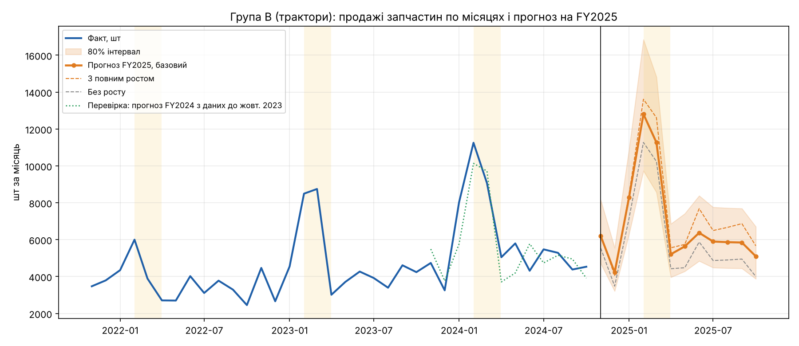

# Прогноз попиту на FY2025

Група B: запчастини до тракторів. Горизонт прогнозу: бюджетний рік FY2025, тобто листопад 2024 – жовтень 2025. Історія: 36 повних місяців (листопад 2021 – жовтень 2024), неповний листопад 2024 не використовується.

Код: [forecast/forecast_fy2025.py](../forecast/forecast_fy2025.py). Усі таблиці лежать у [forecast/out/](../forecast/out/), там же Excel з усіма аркушами (forecast_FY2025.xlsx).

*Синя лінія: факт. Помаранчева: базовий прогноз, смуга навколо неї 80% інтервал. Зелена пунктирна: перевірка, тобто прогноз FY2024, зроблений лише з даних до жовтня 2023. Жовті смуги: лютий і березень.*

## Головний результат

| Місяць | Сезонний індекс | Без росту, шт | **Базовий, шт** | З повним ростом, шт | 80% інтервал, шт |
|---|---:|---:|---:|---:|---:|
| листопад 2024 | 0,93 | 5 540 | **6 193** | 6 304 | 4 707 – 8 148 |
| грудень | 0,59 | 3 478 | **4 222** | 4 037 | 3 209 – 5 555 |
| січень 2025 | 1,21 | 7 154 | **8 287** | 8 471 | 6 299 – 10 903 |
| **лютий** | 1,90 | 11 270 | **12 806** | 13 613 | 9 733 – 16 848 |
| **березень** | 1,73 | 10 237 | **11 266** | 12 613 | 8 563 – 14 823 |
| квітень | 0,75 | 4 422 | **5 209** | 5 558 | 3 959 – 6 854 |
| травень | 0,76 | 4 478 | **5 633** | 5 741 | 4 282 – 7 411 |
| червень | 0,99 | 5 872 | **6 371** | 7 680 | 4 843 – 8 383 |
| липень | 0,82 | 4 868 | **5 897** | 6 494 | 4 482 – 7 758 |
| серпень | 0,83 | 4 897 | **5 863** | 6 664 | 4 456 – 7 714 |
| вересень | 0,83 | 4 947 | **5 843** | 6 867 | 4 441 – 7 688 |
| жовтень 2025 | 0,68 | 4 000 | **5 095** | 5 664 | 3 873 – 6 704 |
| **Разом за рік** | | **71 163** | **82 685** | **89 706** | |

- Базовий прогноз на FY2025: близько **82,7 тис. шт**, це +16% до FY2024 (71 162 шт).
- Лютий і березень дають 29% річного попиту. Пік лютого (≈ 12,8 тис.) приблизно втричі вищий, ніж грудень (≈ 4,2 тис.).
- Розумний діапазон на рік: від 71 тис. (ріст зупиниться) до 90 тис. (ріст як в останні два роки).
- Інтервал для окремого місяця широкий: типова похибка місяця близько +-24%. Інтервали місяців не можна просто додавати, щоб отримати річний інтервал, бо помилки місяців частково гасять одна одну. Для року краще дивитися на три сценарії.

## Як будували прогноз

Порівняли шість простих моделей. Усі працюють з місячними продажами групи в штуках.

| Модель | Ідея |
|---|---|
| M1 | Той самий місяць торік (базова модель для порівняння) |
| M2 | Той самий місяць торік, помножений на річний ріст |
| M3 | Сезонний індекс × середній місяць останнього року, без росту |
| M4 | Сезонний індекс × рівень × повний річний ріст |
| M5 | Сезонний індекс × рівень × половина річного росту |
| M6 | Holt-Winters: мультиплікативна сезонність і загасаючий тренд |

Сезонні індекси рахували після прибирання тренду: кожен місяць ділили на центроване 12-місячне ковзне середнє, потім середнє 12 індексів нормували до 1. Тому індекси трохи відрізняються від таблиці в [сезонність-попиту.md](сезонність-попиту.md): там індекси без прибирання росту, і через ріст початок року (листопад, грудень) виходить заниженим, а кінець року завищеним. Висновок той самий: пік у лютому–березні, найслабший грудень.

Базовий прогноз = середнє M5 і M6. M6 найточніша на перевірці, а M5 проста і зрозуміла. Обидві обережно закладають ріст: ми не впевнені, що ріст +27% на рік триватиме. Частину минулого росту дало розширення каталогу, а в FY2024 майже всі позиції вже мали історію (покриття ≈ 100%), тож цей ефект далі не повториться. M3 (без росту) і M4 (повний ріст) використовуємо як нижній і верхній сценарії.

## Перевірка на минулому

**Перевірка А.** Навчили моделі лише на FY2022–FY2023 (24 місяці) і спрогнозували всі 12 місяців FY2024 наперед. Потім порівняли з фактом.

| Модель | MAE, шт/міс | WAPE | Похибка річної суми |
|---|---:|---:|---:|
| M1 той самий місяць торік | 1 297 | 21,9% | −21,2% |
| M2 торік × ріст | 1 089 | 18,4% | +1,4% |
| M3 індекс без росту | 1 374 | 23,2% | −21,2% |
| M4 індекс × ріст | 1 135 | 19,2% | +0,7% |
| M5 індекс × ½ росту | 1 128 | 19,0% | −10,3% |
| **M6 Holt-Winters** | **919** | **15,5%** | **−0,6%** |

**Перевірка Б.** Ковзні зрізи всередині FY2024: на кожному кроці модель бачить тільки минулі місяці і прогнозує на 1 і на 3 місяці вперед.

| Модель | WAPE, 1 міс | WAPE, 3 міс |
|---|---:|---:|
| M1 | 21,9% | 23,3% |
| M2 | 20,1% | 18,3% |
| M3 | 19,2% | 20,7% |
| M4 | 17,7% | 17,0% |
| M5 | 17,9% | 18,1% |
| **M6** | **16,2%** | **13,9%** |

Висновки з перевірки:
- Усі моделі з сезонністю й ростом кращі за базову M1. Модель без росту стабільно занижує попит приблизно на 20%, бо ринок ріс.
- Holt-Winters найкраща в обох перевірках. Модель M5 у FY2024 занизила рік на 10%, бо ріст тоді не сповільнився. Тому базовий прогноз може бути трохи обережним, якщо ріст триватиме.
- MAPE не рахували, а використовували MAE і WAPE, як і домовлялися.

## Прогноз по серіях

Сезонність серій майже однакова, а малі серії дуже шумні. Тому річний прогноз групи поділили між серіями за їх часткою в FY2024, а по місяцях використали груповий сезонний профіль.

| Серія | FY2022 | FY2023 | FY2024 | Частка FY2024 | Прогноз FY2025 |
|---|---:|---:|---:|---:|---:|
| 8-ї серії | 34 671 | 46 130 | 55 796 | 78,4% | 64 831 |
| 6-ї серії | 4 815 | 5 427 | 7 549 | 10,6% | 8 771 |
| 6B | 1 923 | 2 675 | 3 858 | 5,4% | 4 483 |
| 9-ї серії | 1 006 | 765 | 1 928 | 2,7% | 2 240 |
| 7-ї серії | 844 | 846 | 1 552 | 2,2% | 1 803 |
| інші | 278 | 216 | 479 | 0,7% | 557 |

## Прогноз по позиціях (SKU)

На рівні окремої деталі попит дуже рідкий: 88% позицій продаються не частіше ніж 3 місяці на рік, а 7 157 позицій не мали жодного продажу за останні 12 місяців. Тому місячний прогноз окремої деталі не має сенсу, даємо річний.

- Річна база SKU = середнє продажів FY2023 і FY2024. Для позицій, які мають лише один рік історії, береться тільки FY2024. Якщо в році є невідомі місяці, рахуємо середнє за відомі місяці × 12.
- Потім усі SKU масштабуються так, щоб їх сума дорівнювала базовому прогнозу групи (коефіцієнт 1,236). Тобто прогнози SKU, серій і групи узгоджені.
- Перевірка на FY2024: похибка на рівні SKU висока, WAPE близько 60% (для рідкого попиту це нормально). Метод "середнє двох років" майже не має зсуву (−2,6%), а "лише останній рік" занижує на 18%, тому обрали середнє двох років.

| Тип попиту | Кількість SKU | Частка прогнозу |
|---|---:|---:|
| регулярний (7+ місяців з продажами) | 683 | 51,4% |
| нерегулярний (4–6 місяців) | 878 | 19,6% |
| рідкісний (1–3 місяці) | 3 732 | 19,1% |
| без продажів за 12 міс (були раніше) | 7 157 | 5,1% |
| коротка історія (рік не повний) | 948 | 4,7% |

Половину всього попиту дають лише 683 регулярні деталі. Таблиця по кожній позиції: [forecast_SKU_FY2025.csv](../forecast/out/forecast_SKU_FY2025.csv).

## Що передати частині 5 (скільки запасу тримати)

- Місячний прогноз групи і серій: [forecast_group_FY2025.csv](../forecast/out/forecast_group_FY2025.csv), [forecast_series_FY2025_monthly.csv](../forecast/out/forecast_series_FY2025_monthly.csv).
- Невизначеність на рівні групи: стандартне відхилення логарифма похибки місяця σ ≈ 0,21 (приблизно +-24% на місяць). Для попиту за період L+R можна брати прогноз за ці місяці і цю похибку.
- Для окремих SKU нормальний розподіл не підходить, бо продажі рідкі. Краще брати розподіл Пуассона (або негативний біноміальний для нерівних деталей) із середнім = місячний прогноз SKU × (L+R).
- Пік лютого–березня важливий для замовлення S3: замовлення з терміном 3 місяці треба робити приблизно в листопаді–грудні, щоб деталі встигли до піку.

## Обмеження

- **Продажі не дорівнюють попиту.** Якщо деталі не було на складі, продажу не сталося. Реальний попит, особливо в пік, може бути вищим.
- **Лише три роки історії.** На кожен місяць є тільки три спостереження, тож індекси неточні. Особливо лютий і березень, які в різні роки міняються місцями.
- **Ріст невідомо чи продовжиться.** Ми не знаємо причин росту (нові трактори в регіоні, війна, ціни). Тому даємо три сценарії, а не одне число.
- **Ковзна перевірка використовує лише 12 місяців FY2024.** Цього мало, щоб надійно вибрати одну модель, тому базовий прогноз є середнім двох моделей.
- Прогноз зроблено для історичного зрізу 12.11.2024, як навчальна задача.
