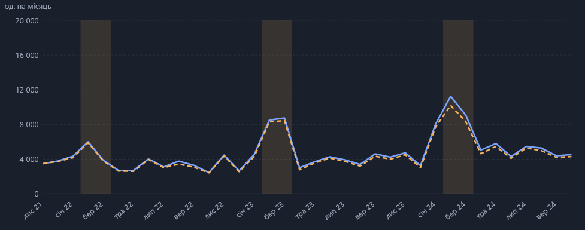

# Аналіз сезонного попиту

Група B: запчастини до тракторів. Продажі за 36 повних місяців (листопад 2021 — жовтень 2024).

*Синя суцільна лінія — усі позиції групи B (13 398). Помаранчева пунктирна — стала когорта (8 295 позицій, що мають усі 36 місяців історії). Жовта смуга — лютий і березень кожного року. По осі Y — продано штук за місяць.*

## Спостереження
- Є стійкий зимово-весняний пік. Лютий + березень = 27% річних продажів (усі позиції) за середнім із трьох років (якби попит був рівномірний, це було б 16,7%). Січень теж вище середнього (1,18), а грудень — найслабший місяць (0,72). Що означають ці числа, див. «Як читати числа» нижче.
- Попит росте. Річні продажі: 43 537 → 56 059 → 71 162 од. (+28,8% у FY2023 і +26,9% у FY2024).
- Це не лише нові позиції. На сталій когорті 8 295 позицій зростання майже таке саме: +27,3% і +24,1%. Ріст каталогу пояснює меншу частину, але когорта не гарантує однакової активності товарів.

## Таблиця сезонності (для прогнозу)

Місяці йдуть у порядку бюджетного року: листопад → жовтень.

| Місяць | Середні продажі за 3 роки, шт | У скільки разів проти середнього місяця: усі позиції | Те саме: стала когорта | Те саме: серія 8 |
|---|---:|---:|---:|---:|
| листопад | 4 224 | 0,90 | 0,92 | 0,93 |
| грудень | 3 233 | 0,72 | 0,72 | 0,77 |
| січень | 5 641 | 1,18 | 1,18 | 1,19 |
| **лютий** | 8 581 | **1,79** | 1,79 | 1,83 |
| **березень** | 7 233 | **1,49** | 1,49 | 1,52 |
| квітень | 3 588 | 0,75 | 0,73 | 0,71 |
| травень | 4 067 | 0,84 | 0,84 | 0,79 |
| червень | 4 201 | 0,92 | 0,93 | 0,92 |
| липень | 4 168 | 0,87 | 0,88 | 0,83 |
| серпень | 4 151 | 0,89 | 0,86 | 0,86 |
| вересень | 4 092 | 0,88 | 0,87 | 0,87 |
| жовтень | 3 740 | 0,78 | 0,78 | 0,77 |

Ці ж числа лежать у файлі [сезонність-індекси.csv](сезонність-індекси.csv) (відкривається в Excel).

Сезонність майже однакова для всіх позицій, для сталої когорти й для серії 8 (на неї припадає ≈ 78% продажів). Отже, піки не є наслідком зміни асортименту.

## Чи повторюється сезонність щороку

| Місяць | FY2022 | FY2023 | FY2024 |
|---|---:|---:|---:|
| листопад | 0,96 | 0,96 | 0,80 |
| грудень | 1,04 | 0,57 | 0,55 |
| січень | 1,20 | 0,97 | 1,35 |
| лютий | 1,65 | 1,82 | 1,90 |
| березень | 1,07 | 1,87 | 1,53 |
| квітень | 0,75 | 0,64 | 0,85 |
| травень | 0,74 | 0,79 | 0,98 |
| червень | 1,11 | 0,91 | 0,73 |
| липень | 0,86 | 0,84 | 0,92 |
| серпень | 1,04 | 0,73 | 0,89 |
| вересень | 0,91 | 0,99 | 0,74 |
| жовтень | 0,68 | 0,91 | 0,76 |

Пік у лютому–березні є в усіх трьох роках. Частка лютого + березня в річних продажах: 22,7% (FY2022), 30,8% (FY2023), 28,6% (FY2024). Тобто пік стабільний, але його сила коливається.

## Обмеження

- **Продажі не дорівнюють попиту.** Якщо деталі не було на складі, продажу не відбулося, хоча попит був. Реальний попит у пікові місяці може бути вищим.
- **Лише три роки.** На кожен місяць припадає по три спостереження. Лютий і березень міняються місцями між роками (у FY2022 пік був у лютому, у FY2023 у березні), тому надійніше говорити про «лютий–березень разом».
- **Каталог ріс.** У листопаді 2021 дані були по 8 295 позиціях, у жовтні 2024 по 13 396. Тому поряд із усіма позиціями показано сталу когорту.
- **Малі серії** (7-ї, 9-ї, «інші») продають десятки або сотні одиниць на рік, їхня сезонність дуже шумна, висновків з неї не робимо.
- **Причина піку** (підготовка до сівби) лише припущення, у даних її не видно.
